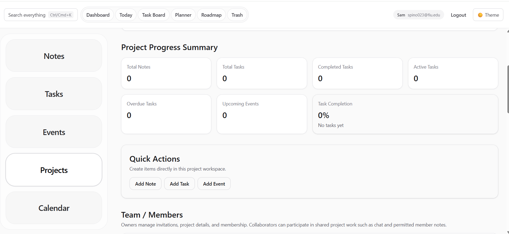
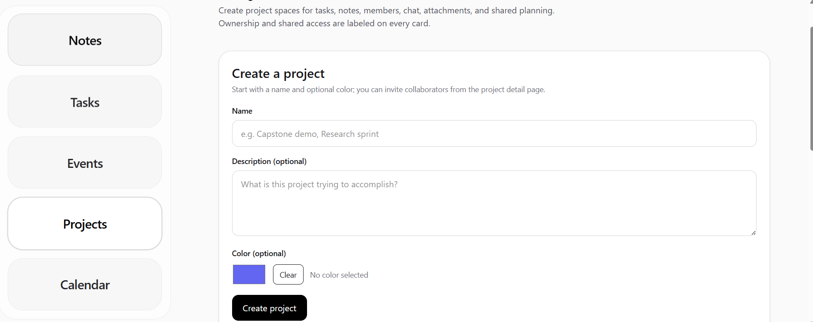
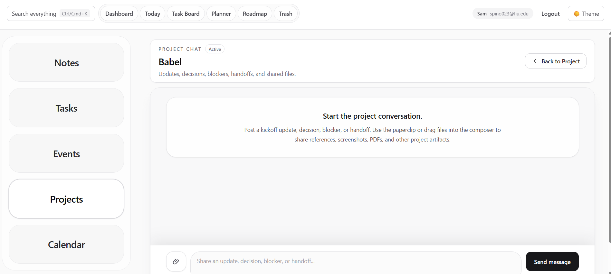

# AI Multi

Live Demo: https://ai-multi-task-management-vercel.vercel.app

## Demo Video
Watch the demo:
https://studio.youtube.com/channel/UCsAQln_0zQCjK95fsJ_kUUA/videos/upload?filter=%5B%5D&sort=%7B%22columnType%22%3A%22date%22%2C%22sortOrder%22%3A%22DESCENDING%22%7D

AI Multi is a full-stack productivity and collaboration platform built with Next.js, TypeScript, Prisma, PostgreSQL, and Vercel. It supports authentication, notes, tasks, events, projects, Kanban project boards, project chat, file uploads, invitations, password reset, search, trash, planning views, recurrence, guest mode, and dark mode.

## Key Features

- Secure authentication with signup, login, logout, sessions, and password reset
- Notes, tasks, events, projects, calendars, a rule-based Smart Daily Planner, and trash recovery
- Project-specific Kanban boards for organizing tasks by status with read-only Viewer access and Owner/Editor task creation and movement
- Project collaboration with invitations and role-based Owner, Editor, and Viewer access enforced server-side
- Project chat with file attachments using local, Vercel Blob, or private AWS S3 storage
- A sidebar where each project opens to its Overview, Board and Chat, and marks chats with new messages

## Project chat attachment storage

Route uploads with `PROJECT_CHAT_DEFAULT_STORAGE_PROVIDER` and
`PROJECT_CHAT_VIDEO_STORAGE_PROVIDER`. For production, ordinary files can use
`vercel-blob` while validated video extensions use private `aws-s3`; local/local
is the normal development configuration. Each attachment records its provider
and key, so later configuration changes do not change where it is read or deleted.

The deprecated `PROJECT_CHAT_STORAGE_PROVIDER` remains a fallback. An explicit
default or video variable wins for its category; otherwise the legacy value is
used, then the video provider falls back to the resolved default, then local is
the final development default.

- `local` writes to `public/uploads/project-chat` and is intended only for local development.
- `vercel-blob` uses `BLOB_READ_WRITE_TOKEN` and optional `PROJECT_CHAT_BLOB_PREFIX`.
- `aws-s3` uses a private S3 bucket. AWS configuration is required only when one routing target selects S3; static access keys remain optional because the SDK default credential provider chain supports IAM roles.

Files stored with `aws-s3` count against a storage cap: 8 GB in total
(`PROJECT_CHAT_S3_QUOTA_BYTES`) and 500 MB per user
(`PROJECT_CHAT_USER_QUOTA_BYTES`). Uploads that would pass either limit are
refused with HTTP 413, and guests can't upload unless
`PROJECT_CHAT_GUEST_UPLOADS_ENABLED="true"`.

When videos route to S3, the browser uploads them directly with a short-lived presigned PUT URL so large video bodies do not pass through a Vercel Function. S3 downloads are authorized by the existing application route before it creates a short-lived presigned GET URL (10 minutes by default). An expiring URL limits the time a copied link can access the private object; it is not a permanent public URL. See [the AWS S3 storage guide](docs/aws-s3-storage.md) for setup, security, Vercel deployment, cleanup, CORS, and cost controls.

Run storage tests with `npm run test:storage`. No test contacts AWS or needs real credentials.

To check a real bucket (AWS S3 or Cloudflare R2), run `npm run verify:storage`
with that bucket's storage variables. It uploads two tiny objects through
presigned URLs, checks that an upload of the wrong size is refused, reads one
back, checks CORS for `APP_BASE_URL`, and deletes both. Point
`DOTENV_CONFIG_PATH` at a separate env file to keep production keys out of `.env`.
- PostgreSQL database modeled with Prisma migrations
- Production deployment on Vercel with Neon PostgreSQL and server-side environment validation
- Smart Daily Planner that analyzes overdue tasks, due-today work, upcoming events, active projects, recent notes, and project follow-up signals without relying on a paid external AI service
- Dark mode and responsive UI

## Testing

```bash
npm run typecheck
npm run lint
npm run test:storage
npm run test:e2e
```

`npm run test:storage` runs Node tests for project-chat attachment validation,
provider selection, S3 upload planning, provider-aware downloads/deletes, and
failure cleanup. These tests mock storage behavior and do not contact AWS.

`npm run test:e2e` starts a local Next.js dev server on port `3100` by default
and runs Playwright browser tests against it. The E2E runner forces
`PROJECT_CHAT_DEFAULT_STORAGE_PROVIDER=local` and
`PROJECT_CHAT_VIDEO_STORAGE_PROVIDER=local`, so E2E attachment tests exercise
the real upload UI without using Vercel Blob or AWS S3. Set `E2E_PORT` to use a
different local port. If you already have a server running, set
`PLAYWRIGHT_BASE_URL` to test that server instead. To test the production
build, run `npm run build` and then `npm run test:e2e` with
`E2E_SERVER_MODE=start`.

### Continuous integration

`.github/workflows/ci.yml` runs on every push to `main` and every pull request.
The first job applies all migrations to an empty PostgreSQL database, fails if
`prisma/schema.prisma` and the migrations disagree, then runs lint (no warnings
allowed), typecheck, unit and storage tests, `npm audit` for high or critical
advisories in production dependencies, and a build. The second job runs the
Playwright tests against the production build with the server in UTC, on a
desktop browser and a phone-sized one.

Every CI run records a video, a trace and screenshots of each Playwright test
and keeps the HTML report as a run artifact for 14 days; the run summary links
to it. Unzip it and open `playwright-report/index.html`, or open a `trace.zip`
at https://trace.playwright.dev.

`.github/workflows/preview-smoke.yml` runs the Playwright tests tagged
`@smoke` (`tests/e2e/smoke.spec.ts`) against each Vercel preview once it is
deployed. Previews share the production database, so smoke tests must stay
read-only: no sign-ups, sign-ins or writes. Preview URLs are behind Vercel
Deployment Protection; the workflow sends the `VERCEL_AUTOMATION_BYPASS_SECRET`
repository secret as the `x-vercel-protection-bypass` header and skips itself
when the secret isn't set. Run them locally with
`npm run test:e2e -- --grep @smoke`.

Dependabot (`.github/dependabot.yml`) opens weekly update PRs for npm packages,
with minor and patch updates grouped, and for GitHub Actions. Major versions
are skipped; security updates still arrive. `dependabot-auto-merge.yml` turns
on auto-merge for each Dependabot PR, so GitHub merges it once every required
check passes and leaves it open if one fails.

CI also fails if any `@radix-ui` package is installed in more than one version
(`scripts/check-single-radix.mjs`). Duplicate Radix copies can break a menu
inside a dialog. The `overrides` entry in `package.json` keeps Prisma Studio on
the app's Radix release; update it when Radix is updated.

On the 1st of each month, `.github/workflows/maintenance-report.yml` opens a
"Monthly maintenance check" issue assigned to the repository owner, so GitHub
sends a notification. It lists major upgrades Dependabot skips, Dependabot PRs
stuck on a failing check, `npm audit` and CodeQL findings, the Node.js
end-of-life date, and a short checklist (usage and billing dashboards). It
closes the previous month's issue. Run it any time from the Actions tab
("Run workflow").

## Tech Stack

- Frontend: Next.js App Router, React, TypeScript, Tailwind CSS
- Backend: Next.js Route Handlers / Server Actions
- Database: PostgreSQL, Prisma ORM, pgAdmin 4
- Storage: local filesystem, Vercel Blob, or private AWS S3 with hybrid routing
- Deployment: Vercel
- Email: optional Gmail SMTP, Brevo or Resend; in-app invitations work without email

## Screenshots

### Dashboard


### Projects


### Project Chat



### Main Task Board

The app includes a dedicated `/board` productivity area linked from the main navigation as **Task Board**. It currently supports:

- **Kanban View** for organizing personal and project tasks by status across the workspace.
- **Tree View** for user-specific editable hierarchy pages, such as Warrior, Study Plan, or Career Plan, with root nodes, child nodes, sibling nodes, renaming, deletion, simple reordering, and parent changes.
- A disabled **Mindnote View** entry point so the board structure can be extended later without changing the primary navigation.

Plans for drag and drop in the Tree View, a 3D Mind View and more sidebar tools are in [docs/views-roadmap.md](docs/views-roadmap.md).
