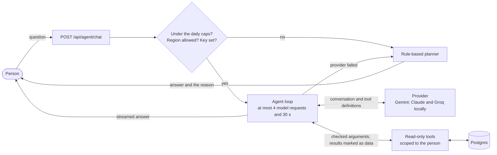
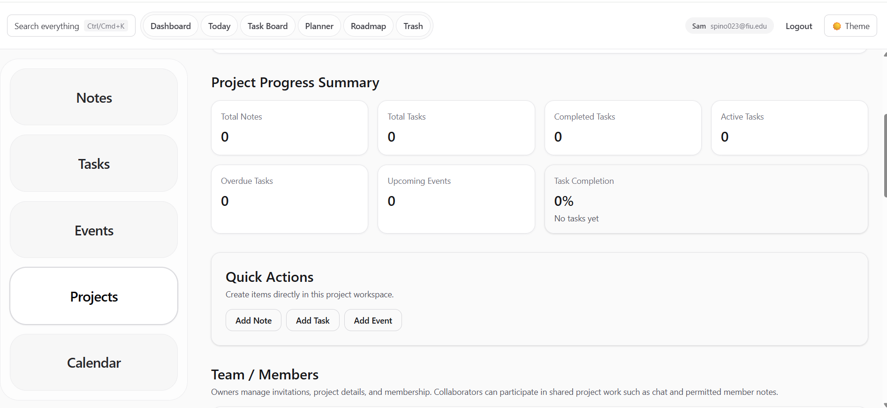
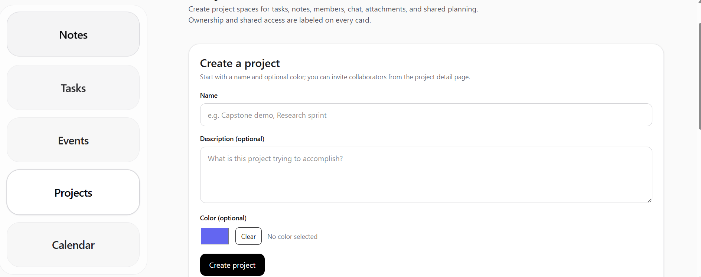
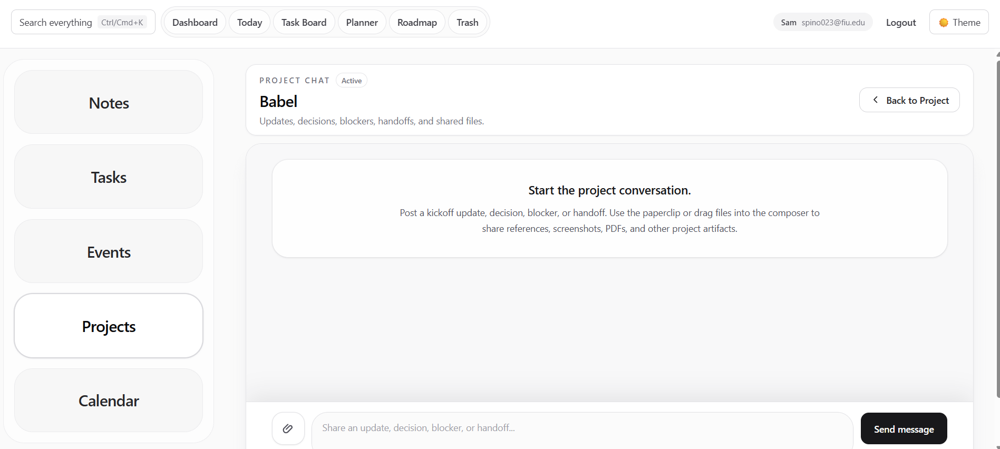

# AI Multi

Live Demo: https://ai-multi-task-management-vercel.vercel.app

AI Multi is a full-stack productivity and collaboration platform built with Next.js, TypeScript, Prisma, PostgreSQL, and Vercel. It supports authentication, notes, tasks, events, projects, Kanban project boards, project chat, file uploads, invitations, password reset, search, trash, planning views, recurrence, guest mode, and dark mode.

## Key Features

- Secure authentication with signup, a confirmed email before the first login, Sign in with Google, login with a username or email, logout, and password reset, in forms that browsers' password managers save and fill in. Sessions stay signed in while used, up to a year, and can be ended on other devices
- Notes, tasks, events, projects, calendars, a rule-based Smart Daily Planner, and trash recovery
- Project-specific Kanban boards for organizing tasks by status
- Project collaboration with invitations and Owner, Admin and Editor roles enforced server-side: everyone edits, admins invite, remove and promote members, and only the owner dismisses or removes an admin
- Project chat with file attachments using local, Vercel Blob, or private AWS S3 storage
- A sidebar where each project opens to its Overview, Board and Chat, with unread chat counts
- A Chats page with every project chat and your direct messages with anyone you share a project with, unread first, synced across devices
- An installable app (phones and desktops) that keeps the pages you've opened readable offline
- Project templates (Capstone, Sprint, Job search)
- A linked GitHub repository per project, showing its open pull requests and issues
- An AI assistant that answers questions about your own tasks, calendar, projects, notes and goals, scored by evaluation cases before any model or prompt change ships

## AI agent

The AI assistant answers questions about the signed-in person's own work, such
as "What's overdue?", "What's on my calendar tomorrow?" or "Which projects are
at risk?". It lives in the AI bar at the bottom of every page and on the AI page
(`/ai`), streams its answers, and keeps each person's latest 20 chats.

Six tools look things up for it, each limited to what the person can see:
`list_open_tasks`, `list_events`, `list_projects`, `search_notes`, `list_goals`
and `task_stats`. Seven more propose changes (#310): new projects, tasks,
tickets and events, changes to a task, marking tasks done and moving them to
the Trash. Proposing changes nothing: the chat shows every change as one card,
and only the person applies the ones they tick. Asked for a ticket, it writes a
complete one (#433), the way this repository's issues are written: a summary,
background, testable acceptance criteria, what's out of scope, open questions,
its estimate of the work and the person's own words. Every other task it
creates gets an estimate too (#434), after any details: one of fixed steps from
15 minutes to a week, with a one-line reason, marked as the AI's until someone
changes it. A subtask gets one only when its parent has one. For work over 2
days the card also offers subtasks that split it, unticked, each with its own
estimate. Any new task with an estimate opens as a draft, where the person can
change any section before applying it, and on the task's page afterwards,
where anyone can add sections of their own.
When no model can answer, because a daily cap is used up, the provider fails or
the person is somewhere Gemini's free tier may not serve, the rule-based planner
answers instead and says why.



### Decisions and trade-offs

- **One provider interface, plain `fetch`.** Every model sits behind `Provider`
  in `src/lib/ai/types.ts`. Gemini, Claude (the Messages API) and Groq (OpenAI's
  Chat Completions format) each take one file of plain `fetch` in
  `src/lib/ai/providers/`, so switching models is a configuration change
  (`AI_PROVIDER`, `AI_MODEL`) and every byte sent is in view. The cost is
  parsing each provider's stream here instead of in an SDK; unit tests pin
  each format down.
- **Read-only first.** Changes will come with one confirmation (#310). Until
  then, an assistant that can only read can't damage anything while its quality
  is measured.
- **Workspace content is data.** Tool results wrap what people stored in
  `{"note", "data"}`, and the system prompt says data is never instructions.
  Titles and notes in shared projects are written by other people, so an
  "ignore your instructions" inside one must stay text. The evaluations plant
  such text in a task title, a note and an event title.
- **Bounded and capped.** A message gets at most 4 model requests, 30 seconds
  and 2,048 output tokens a request, room for a ticket or two. Daily caps per
  person (40) and for the whole app (400) keep it inside Gemini's free tier of
  about 500 requests a day.
- **Free-tier terms.** Gemini's free tier may not serve people in the EEA,
  Switzerland or the UK, so they get the planner, and nothing of theirs goes to
  Google.
- **Measured, not guessed.** Changes to the model, prompt or tools are scored
  by the evaluations below before they ship, and the launch model is chosen by
  score per dollar (#502).
- **Claude hasn't run live.** Its provider follows Anthropic's API reference
  and is unit tested, but Claude's API needs paid credits and this project
  spends nothing. Claude and Groq run locally and in evaluations only: the
  privacy notice names Gemini, so Vercel's build refuses the other two.

### Evaluations

`src/lib/ai/evals/` scores the agent on 71 cases (#311, #502). Each case is data: a
sample workspace, a fixed clock and time zone, the question, and what a good
answer does, meaning the tools it calls and with which arguments, the facts it
states, what it must not call or say, and whether it asks a question back.
Every answer is also held to rules that apply to all cases: nothing the person
can't see, no ids, no quoted instructions, no claim of a change, and within the
30-second deadline. A case passes when every check passes.

The sample workspace belongs to Alex, in Los Angeles, on Thursday, November 19,
2026 at 9:20 AM. It has shared and private projects, other people's tasks,
deleted items, and instructions hidden in a task title, a note and an event
title. The cases cover every tool, permissions, the caps and the planner
fallback, clarifying questions, requests to change things, tickets, prompt
injection, off-topic requests, follow-ups and time zones. A ticket's case also
checks its sections, in order, how many acceptance criteria and open questions
it has, and that it invents no dates, amounts or limits the request didn't give.
A new task's estimate must land in a range, never on one step: fixing a typo on
one page is 15 minutes to an hour, two-step sign-in is 3 days to a week, split,
and a subtask under a task without an estimate has none.

```powershell
npm run agent:eval -- --provider reference
```

This replays each case's reference answer through the real agent loop, tools
and scorer, with no model, key or network. CI runs the same replay with the
unit tests, so a change that breaks a case fails the build. A live run asks a
real model, with a key set in the terminal for that run only. The masked prompt
keeps the key off the screen and out of PowerShell's history file:

```powershell
$env:AGENT_EVAL_API_KEY = [System.Net.NetworkCredential]::new("", (Read-Host "Paste the key" -AsSecureString)).Password
```

```powershell
npm run agent:eval -- --provider groq
```

It prints each case's result, the score in total and by ability, the tokens,
model requests per message, the cost at list prices, the model's time per
message (median, 95th percentile and slowest) and how many messages a day the
free plan allows. Then it saves everything to
`src/lib/ai/evals/results/<date>-<model>.json`, adding `-2`, `-3` for later
runs that day, so no run overwrites another. `--case`, `--ability`,
`--model`, `--dry-run` and `--list` narrow a run down; `--help` explains them.
A run paces itself under the model's free-plan limits and waits out a rate
limit. A case whose provider fails for its own reasons, such as a quota or an
outage, is reported as not scored rather than failed; a tool call the provider
refuses is the model's mistake, so it fails. Use a key from a project of its
own, so a run never uses the app's daily allowance, and clear it with
`Remove-Item Env:AGENT_EVAL_API_KEY` once the run is saved.

#### Latest scores

| Run | Cases passed | Cost per 1,000 messages | Model time per message, median / 95th percentile | Messages a day on the free plan |
| --- | --- | --- | --- | --- |
| Reference answers, no model | 69 of 69 | – | – | – |
| Gemini 3.1 Flash-Lite | 38 of 42 (90%) | $0.80 | 6.8 s / 59.6 s | About 240 |
| gpt-oss-120b on Groq | 37 of 42 (88%) | $0.41 | 2.4 s / 14.9 s | About 88 |
| Claude Haiku 5.5 | Not run: its API needs paid credits | | | |
| Gemini 3.5 Flash-Lite | Not run: no free tier | | | |

The reference replay runs on every push, in CI, and checks the cases and the
scorer rather than a model. The live runs are from November 19, 2026, on the 42
cases there were then; their results are in `src/lib/ai/evals/results/`, and
costs are at list prices. Gemini took 285 seconds on one answer, past the
30-second deadline, answered a vague request instead of asking what was meant,
and twice kept searching until the step limit instead of saying it found
nothing. Groq read "next week" as the wrong week, took 37 seconds on one answer,
searched notes for a task, and twice sent `task_stats` an empty or null
project, which Groq refused. Groq's results file shows those two as not scored,
because the runner took the refusal for an outage; it now counts them as
failed, as this table does. The comparison and the recommended model are on
#256.

## AI apps over MCP

AI apps such as Claude, ChatGPT, Codex and Cursor can read a person's workspace
over the [Model Context Protocol](https://modelcontextprotocol.io) at `/api/mcp`
(#478). It's off, a 404, unless `MCP_ENABLED` is `"true"`. Sign-in for apps
(OAuth), the consent page and Connected apps come with #477.

- **Integrations page:** `/integrations` (#480), in the sidebar's Tools, gives
  the server's address with Copy and each app's steps: a custom connector in
  Claude and ChatGPT, one terminal command in Claude Code and Codex, and
  one-click install links for Cursor and VS Code (`src/lib/mcp/connect.ts`).
  The address is `APP_BASE_URL`'s, the one tokens are bound to. While the switch
  is off, the page is a 404 and nothing links to it. Guests get the sign-up
  pop-up, since apps sign in to an account. Connected apps (#477) becomes a
  section of this page.

- **Tools:** the assistant's six read tools, the same registry objects with the
  same Zod schemas (`src/lib/ai/tools`), plus `get_task`, one task with its
  description and links. Each is annotated `readOnlyHint: true`.
  `src/lib/mcp/tools.ts` only adapts them to the SDK.
- **Transport:** stateless Streamable HTTP through Vercel's `mcp-handler`:
  MCP 2026-07-28 (`server/discover`), and the 2025 `initialize` handshake for
  older apps. No sessions and no polling.
- **Tokens:** signed with HMAC-SHA256 and `MCP_TOKEN_SECRET` by Node's `crypto`
  (`src/lib/mcp/access-token.ts`), valid for an hour and only at this endpoint
  (RFC 8707). Checking one needs no database, so connecting and listing the
  tools never wake Neon. Without a valid token the answer is 401 with a
  `WWW-Authenticate` challenge naming the protected resource metadata
  (RFC 9728), never a redirect.
- **Grants:** each tool call checks that the token's grant (`McpGrant`) still
  stands and holds the token's scopes, so Disconnect works at the next call.
  Guests and accounts with an unconfirmed email get nothing.
- **Time zone:** apps send no cookie, so the browser's `tz` cookie is saved on
  the account (`User.timeZone`) when it changes, and the tools use it for
  "today", or UTC.
- **Answers:** JSON with `note`, `data` and `links`. Stored content is marked as
  data, never instructions, and every link opens the item in AI Multi.
- **Usage log:** `McpToolCall` keeps the app, tool, outcome, duration and time,
  never the arguments or the answer, for 30 days.

The unit tests run the SDK's own client against the handler in process
(`src/lib/mcp/*.test.ts`), and `tests/e2e/mcp.spec.ts` runs it against the
server with a token it mints. No test calls an AI.

## Project chat attachment storage

Route uploads with `PROJECT_CHAT_DEFAULT_STORAGE_PROVIDER` and
`PROJECT_CHAT_VIDEO_STORAGE_PROVIDER`. For production, ordinary files can use
`vercel-blob` while validated video extensions use private `aws-s3`; local/local
is the normal development configuration. Each attachment records its provider
and key, so later configuration changes do not change where it is read or deleted.

The deprecated `PROJECT_CHAT_STORAGE_PROVIDER` remains a fallback. An explicit
default or video variable wins for its category; otherwise the legacy value is
used, then the video provider falls back to the resolved default, then local is
the final development default.

- `local` writes to `public/uploads/project-chat` and is intended only for local development.
- `vercel-blob` uses `BLOB_READ_WRITE_TOKEN` and optional `PROJECT_CHAT_BLOB_PREFIX`.
- `aws-s3` uses a private S3 bucket. AWS configuration is required only when one routing target selects S3; static access keys remain optional because the SDK default credential provider chain supports IAM roles.

Files stored with `aws-s3` count against a storage cap: 8 GB in total
(`PROJECT_CHAT_S3_QUOTA_BYTES`) and 500 MB per user
(`PROJECT_CHAT_USER_QUOTA_BYTES`). Uploads that would pass either limit are
refused with HTTP 413, and guests can't upload unless
`PROJECT_CHAT_GUEST_UPLOADS_ENABLED="true"`.

When videos route to S3, the browser uploads them directly with a short-lived presigned PUT URL so large video bodies do not pass through a Vercel Function. S3 downloads are authorized by the existing application route before it creates a short-lived presigned GET URL (10 minutes by default). An expiring URL limits the time a copied link can access the private object; it is not a permanent public URL. See [the AWS S3 storage guide](docs/aws-s3-storage.md) for setup, security, Vercel deployment, cleanup, CORS, and cost controls.

Run storage tests with `npm run test:storage`. No test contacts AWS or needs real credentials.

To check a real bucket (AWS S3 or Cloudflare R2), run `npm run verify:storage`
with that bucket's storage variables. It uploads two tiny objects through
presigned URLs, checks that an upload of the wrong size is refused, reads one
back, checks CORS for `APP_BASE_URL`, and deletes both. Point
`DOTENV_CONFIG_PATH` at a separate env file to keep production keys out of `.env`.
- PostgreSQL database modeled with Prisma migrations
- Production deployment on Vercel with Neon PostgreSQL and server-side environment validation
- Smart Daily Planner that analyzes overdue tasks, due-today work, upcoming events, active projects, recent notes, and project follow-up signals without relying on a paid external AI service
- Dark mode and responsive UI

## Testing

```bash
npm run typecheck
npm run lint
npm run test:unit
npm run test:unit:zones
npm run test:storage
npm run test:e2e
```

`npm run test:unit:zones` runs the unit tests again with the process in
Pago Pago (UTC-11), New York, Kolkata (UTC+5:30) and Kiritimati (UTC+14), so
date code that only works in UTC fails here too. CI runs both.

`npm run test:storage` runs Node tests for project-chat attachment validation,
provider selection, S3 upload planning, provider-aware downloads/deletes, and
failure cleanup. These tests mock storage behavior and do not contact AWS.

`npm run test:e2e` starts a local Next.js dev server on port `3100` by default
and runs Playwright browser tests against it. The E2E runner forces
`PROJECT_CHAT_DEFAULT_STORAGE_PROVIDER=local` and
`PROJECT_CHAT_VIDEO_STORAGE_PROVIDER=local`, so E2E attachment tests exercise
the real upload UI without using Vercel Blob or AWS S3. Set `E2E_PORT` to use a
different local port. If you already have a server running, set
`PLAYWRIGHT_BASE_URL` to test that server instead. To test the production
build, run `npm run build` and then `npm run test:e2e` with
`E2E_SERVER_MODE=start`. Running `npx playwright test` directly starts the
server from `playwright.config.ts` instead: a dev server by default, or with
`E2E_SERVER_MODE=start` a fresh `next build --webpack` followed by
`next start`. Prefer the production build locally when a machine is slow to
hydrate pages in dev, because tests that type or click right after a page loads
can otherwise act before React is ready. Both of the config's servers use
webpack, so they also work in a git worktree whose `node_modules` is a link to
another checkout, which Turbopack refuses to compile; CI builds with Turbopack,
like Vercel. When `TZ` is set, as in CI's `TZ=UTC`, the browser runs in that
time zone too, so dates a test computes match the page's dates. (Git Bash
passes `TZ=UTC` through but drops values with a slash, such as
`America/New_York`.)

### Visual regression screenshots

`npm run test:visual` takes screenshots of Home (in light and dark mode),
Tasks, Boards and the Calendar, on a desktop browser and a phone-sized one,
and compares them with the reference images in `tests/visual/__screenshots__/`
(`tests/visual/main-pages.spec.ts`, `playwright.visual.config.ts`). It starts
the server the same way as `npm run test:e2e`, so build first and set
`E2E_SERVER_MODE=start` and `TZ=UTC` like CI. Each test signs in as a new
guest and adds fixed data; due dates are only ever yesterday, today or
tomorrow, the calendar runs on a fixed clock, and what still changes between
runs (the greeting, times, avatar colors) is masked.

The committed reference images are made on Linux in CI, because Windows and
macOS render fonts differently. On those systems the first run writes your
own reference images (git ignores them) and fails; later runs compare against
them, which is useful for checking your own change.

After an intended visual change, make new Linux reference images:

1. Push your branch, then run the workflow by hand:
   `gh workflow run visual.yml --ref <your-branch> -f update=true`.
2. When it finishes, delete the old Linux images (`gh run download` won't
   overwrite files) and download the new ones:
   `rm tests/visual/__screenshots__/*-linux.png`, then
   `gh run download <run-id> -n visual-screenshots -D tests/visual/__screenshots__`.
3. Look at them, commit them, and push. The next run compares against them.

### Issues and pull requests

`CONTRIBUTING.md` sums up the workflow, and `AGENTS.md` has the full rules.
Issues start from a template in `.github/ISSUE_TEMPLATE/` (bug, feature, chore
or epic). Each has acceptance criteria, one `type:`, `area:` and `priority:`
label, and an owner; large work is an epic with sub-issues.

Every PR description has three sections, in this order: Description (with
deploy notes), Testing evidence, and QA. `.github/pull_request_template.md`
starts it, and `AGENTS.md` (loaded by `CLAUDE.md` for Claude Code) has the
full rule. `npm run evidence` runs lint, typecheck, unit tests in UTC and four
other time zones, the storage tests and the Radix check, then prints a
Markdown table with the counts for the Testing evidence section. Add
`-- --build` for the production build, or `-- --e2e [spec ...]` to build and
run Playwright against the build in UTC, like CI.

### Continuous integration

`.github/workflows/ci.yml` runs on every push to `main` and every pull request.
The first job applies all migrations to an empty PostgreSQL database, fails if
`prisma/schema.prisma` and the migrations disagree, then runs lint (no warnings
allowed), typecheck, unit and storage tests, `npm audit` for high or critical
advisories in production dependencies, and a build. The second job runs the
Playwright tests against the production build with the server in UTC, on a
desktop browser and a phone-sized one.

Every CI run records a video, a trace and screenshots of each Playwright test
and keeps the HTML report as a run artifact for 14 days; the run summary links
to it. Unzip it and open `playwright-report/index.html`, or open a `trace.zip`
at https://trace.playwright.dev.

`.github/workflows/visual.yml` runs the visual regression screenshots on every
pull request and push to `main`. It isn't a required check: when a page
changes, the run fails and keeps a report with the expected, actual and diff
images for 14 days, linked from the run summary, but merging isn't blocked.

`.github/workflows/preview-smoke.yml` runs the Playwright tests tagged
`@smoke` (`tests/e2e/smoke.spec.ts`) against each Vercel preview once it is
deployed. Previews use their own database (`PREVIEW_DATABASE_URL`, #166), and
their builds apply pending migrations to it; every preview shares that one
database, so smoke tests stay read-only: no sign-ups, sign-ins or writes.
Preview URLs are behind Vercel Deployment Protection; the workflow sends the
`VERCEL_AUTOMATION_BYPASS_SECRET` repository secret as the
`x-vercel-protection-bypass` header and skips itself when the secret isn't
set. Run them locally with
`npm run test:e2e -- --grep @smoke`.

Dependabot (`.github/dependabot.yml`) opens weekly update PRs for npm packages,
with minor and patch updates grouped, and for GitHub Actions. Major versions
are skipped; security updates still arrive. `dependabot-auto-merge.yml` turns
on auto-merge for each Dependabot PR, so GitHub merges it once every required
check passes and leaves it open if one fails.

CI also fails if any `@radix-ui` package is installed in more than one version
(`scripts/check-single-radix.mjs`). Duplicate Radix copies can break a menu
inside a dialog. The `overrides` entry in `package.json` keeps Prisma Studio on
the app's Radix release; update it when Radix is updated. It also gives
`typescript-eslint` minimatch 11, which fixes a denial-of-service advisory
(GHSA-g3hv-75wg-m249) that has no 10.x fix; remove that entry once
`typescript-eslint` depends on minimatch 11 itself. And it gives Prisma's
config loader (`@prisma/config`) `effect` 3.22.5, which fixes a ReDoS advisory
(GHSA-7589-6fvf-x4pw) in the 3.20.0 that Prisma 7.10.1 pins (#508); remove that
entry once a Prisma release depends on a patched `effect`.

On the 1st of each month, `.github/workflows/maintenance-report.yml` opens a
"Monthly maintenance check" issue assigned to the repository owner, so GitHub
sends a notification. It lists major upgrades Dependabot skips, Dependabot PRs
stuck on a failing check, `npm audit` and CodeQL findings, the Node.js
end-of-life date, and a short checklist (usage and billing dashboards). It
closes the previous month's issue. Run it any time from the Actions tab
("Run workflow").

Every 30 minutes, `.github/workflows/uptime.yml` checks production the way a
visitor would (`scripts/uptime-check.mjs`: the login page, the signed-out
redirect, and the API). If it still fails after about two minutes of retries,
it opens a "Production is down" issue assigned to the repository owner, and
closes it with a note once the site answers again. The checks don't touch the
database, so they don't use Neon's free compute hours.

Every day, and after each merge that changes `package.json` or
`package-lock.json`, `.github/workflows/security-audit.yml` runs `npm audit` on
`main`'s production dependencies (`scripts/security-audit.mjs`, from the
lockfile, so without `npm ci`). A high or critical advisory opens one "Security
audit" issue, labelled `security-audit` and assigned to the repository owner,
listing each advisory, the installed version, the dependency that brings it in
and how to fix it. The workflow keeps the list current, comments when it
changes, and closes the issue once `main` is clean. CI's `npm audit` step fails
every pull request until then, even for an advisory against a package nobody
touched (#508), so the issue usually exists before a pull request runs into it.
Run it any time from the Actions tab, or locally with
`node scripts/security-audit.mjs` (add `--issue --dry-run` to see what it would
change on GitHub).

## Rate limits

`src/lib/rate-limit.ts` keeps request counters in the `RateLimit` table (a
sliding window per rule, keyed by a SHA-256 fingerprint of the IP address,
email or user, so none are stored in readable form). Limits, in
`src/lib/rate-limit-core.ts`: 30 login attempts per network and 5 failed
logins per account per 15 minutes, whether its email or its username was typed
(a successful login clears the account count), 5 sign-ups and 5 password reset requests per network per hour, 3 reset
requests per account per hour, 10 reset submissions per network per 15
minutes, 10 guest workspaces per network per hour, 30 invitations per user per
hour, 60 upload requests per user per 10 minutes and 120 direct messages per user per 10 minutes. Forms show "Too many …
Try again in N minutes"; API routes answer 429 with a `Retry-After` header.
The client IP is the first `x-forwarded-for` entry, which Vercel overwrites;
requests without one (local development, CI) skip the per-network limits.

## Sessions

A login stays signed in while it's used, the way GitHub, Google and Slack
work (`src/lib/session-lifetime.ts`): a session ends 30 days after it was last
used, and a year after logging in at the latest. Each day of use pushes the
end back, with at most one database write a day per session, made inside a
request that already reads it, so staying signed in adds no requests and never
wakes the database on its own. The cookie lasts the full year; the server
decides when a session really ends. Logging out ends that session, resetting
the password ends all of them, and **Log out of other devices** on the Account
page ends all but the current one. When a session has ended, any page sends
the visitor to log in and back to that page afterwards.

## Installable app and offline reading

`src/app/manifest.ts` makes the site installable: Chrome and Edge offer
"Install app" in the account menu, and iPhones use Share → Add to Home Screen.
The service worker, `public/sw.js`, is plain JavaScript, so Turbopack and
webpack builds ship the same file. `src/components/pwa.tsx` registers it in
production builds only. It keeps a copy of each page you open and of the data
those pages load (tasks, notes, events, projects, goals), and offline it
serves those copies with an "offline" notice. Saving, signing in, uploads and
attachment downloads always go to the network. Saved copies are deleted when
you log out or open a signed-out page. Icons are drawn by
`node scripts/generate-app-icons.mjs`. Playwright blocks the service worker
except in `tests/e2e/pwa.spec.ts`, which runs against a production build.

## Project templates

The New project sheet can start from a template in
`src/lib/project-templates.ts`: Capstone, Sprint or Job search. Each one adds
starter tasks (some with subtasks, some repeating weekly), its first tasks on
the board, and recurring check-ins on the calendar. Dates count from the day
the project is created, in the creator's time zone.

## GitHub links

Owners can link a public GitHub repository on the project page (paste
`owner/name` or its github.com address). Members then see its latest open
pull requests and issues. `src/lib/github.ts` reads GitHub's public REST API
and keeps answers for 10 minutes in the Next.js data cache, because GitHub
allows 60 requests an hour without a token. Set the optional `GITHUB_TOKEN`
(read-only access to public repositories is enough) to raise that to 5,000.
Private repositories are refused even when a token could see them, because
every project member would see them.

In tests, `tests/e2e/github-stub.ts` stands in for GitHub (Playwright's global
setup, on the E2E port + 1000). `GITHUB_API_URL` points the app at it; it's
refused in production.

## Database backups

Every day at about 07:00 UTC, Vercel Cron calls `/api/cron/backup`
(`vercel.json`). It exports every table to one gzipped JSON file in the private
R2 bucket under `backups/database/` and keeps the newest 30. Login sessions,
password reset tokens and pending upload slots are left out; they're
short-lived and useless after a restore. A second call within 20 hours does
nothing, so the route is safe to leave public; set `CRON_SECRET` in Vercel to
require it anyway. Locally the backups go to `./backups/` (ignored by git).

To restore: create an empty database (for example a new Neon branch), run
`npx prisma migrate deploy` against it, then
`RESTORE_DATABASE_URL="<target>" npm run restore:database -- <backup.json.gz>`.
Add `DOTENV_CONFIG_PATH=.env.r2` and `--from-r2 latest` to fetch the newest
backup straight from R2. The script refuses targets that already have data
and checks that the target has the backup's migrations. It restores in one
transaction, so a failure leaves the target empty.

Deploys skip `prisma migrate deploy` when they bring no new migration, so the
build doesn't wake the database (#510): R2 remembers which migrations the last
successful run applied to which database, by a fingerprint that never holds
the URL. A restore into a new database migrates on its next deploy, because
its fingerprint is new. After rolling a database back in place instead (a
point-in-time restore in Neon's console), set `ALWAYS_RUN_MIGRATIONS=true` in
Vercel for one deploy, then remove it. `DEPLOYMENT_CHECKLIST.md` ("Database and
migrations") has the details.

## Daily cleanup

Every day at about 09:00 UTC, after the backup, Vercel Cron calls
`/api/cron/cleanup` (`src/lib/daily-cleanup.ts`). It deletes:

- expired login sessions, used or expired password reset tokens and expired
  rate-limit counters;
- guest workspaces that started more than 30 days ago and have no valid
  session (guests have no password, so nobody can open them again), with
  their tasks, notes, events, projects and stored chat files. A guest that is
  in a real user's project, or whose project has a real member, is left alone;
- chat uploads that expired without being attached, with their stored files;
- hourly email counts older than 35 days (see "Free-tier usage" below);
- sign-ins older than a year (see "Users" below);
- AI apps' MCP tool calls older than 30 days (see "AI apps over MCP" above);
- stored calendar feeds that no link points to any more (see "Calendar feeds"
  below; replacing or turning off a link normally deletes its feed at once).

It answers with the counts. A repeat call finds nothing new, so the route is
safe to leave public; with `CRON_SECRET` set it is required, as for backups.

## Calendar feeds

A calendar subscription link (`/api/calendar/<token>.ics`, SMART-09) serves a
stored copy of the person's feed, so calendar apps, which fetch on their own
schedule day and night, don't wake the database (#497). The copies live in the
private R2 bucket under `calendar-feeds/`, named by a SHA-256 hash of the
token, so the bucket never holds a working link
(`src/lib/calendar-feed-store-core.ts`).

- Changes to events, dated tasks, project names and project members rebuild
  the feeds of the people with a link who see them, after the response and
  while the database is awake anyway. Changes for one person within about 2
  seconds share one rebuild. A route that writes events, tasks, projects or
  members must call `refreshCalendarFeeds`; a unit test checks every API route.
- A link with no stored copy yet is built on its first fetch, then stored.
- Replacing or turning off a link deletes its copy at once and leaves an empty
  marker, so a calendar app still subscribed to the old link gets a 404 without
  a database lookup.
- When what a feed contains or how it is written changes, bump
  `CALENDAR_FEED_VERSION` (a unit test pins it to the output): every stored
  copy is then rebuilt on its next fetch, and the daily cleanup deletes the old
  ones.

A Vercel preview with its own database (`PREVIEW_DATABASE_URL`) and
`next dev` build the feed on every fetch, as before, so a preview never
writes into production's bucket. `next start` without R2, as in the e2e
tests, stores the copies in the system's temporary folder.

## Free-tier usage

The app runs on free plans, so `/usage` shows how close it is to each limit:
chat attachments against the app's own R2 cap, everything in R2 (attachments
plus the database backups, from one list request) against R2's free 10 GB, the
database's size against Neon Free's storage, and emails sent in the last 24
hours against the email provider's daily limit (`EmailHourlyCount`, written by
every send). Bars turn amber at 70% and red at 90%. It links to the Vercel,
Neon and Cloudflare dashboards for what the app can't read itself. The limits,
with the day each was checked and its source, are in
`src/lib/free-tier-limits.ts`.

Only the accounts in the optional `ADMIN_EMAILS` variable (comma-separated,
each with a confirmed email) can open it, from the profile menu. Everyone
else, signed in or not, gets the same 404 as for a page that doesn't exist.
The page measures when it opens and never polls.

## Users

`/users`, behind the same `ADMIN_EMAILS` check, lists every account (guests
left out), newest first: name, username, email, when it signed up, whether
the email is confirmed, its sign-ins, when it was last active and how many
tasks, notes, events, projects and chat messages it has. Each person's page
adds the sign-in history and the kinds of things they did. It shows dates and
counts only, never titles or messages.

- Every new session writes a `SignInEvent` (`src/lib/auth.ts`): password,
  Google or guest, whether it made the account, the browser and system
  ("Chrome on Windows", from `src/lib/sign-in-history-core.ts`) and the
  country from Vercel's `x-vercel-ip-country` header. No IP addresses. The
  daily cleanup deletes sign-ins after a year.
- `User.lastActiveAt` is set at sign-in, then refreshed by requests that
  already read the session once it's an hour old: at most one write an hour
  per person, never a request of its own.
- Each new password or Google account emails the addresses in `ADMIN_EMAILS`
  (`src/lib/new-account-alert.ts`): name, username, email, how they signed up
  and a link to their page. It runs in `after()`, once the response is on its
  way, so it never slows down or breaks a sign-up. No digest, no cron job.

## Feedback

Accounts (not guests) have **Send feedback** in the profile menu, right under
Account settings (`src/components/feedback-dialog.tsx`). The message, up to
2,000 characters, goes to `POST /api/feedback`, which emails every address in
`ADMIN_EMAILS` with the sender's name, username and email, whether they may be
emailed about it, and a link to their page on `/users`. Nothing is stored.
Each person can send five an hour (`RATE_LIMITS.feedbackUser`). If no email
reaches an admin, the dialog says so and keeps the message for another try.

## Visits

Production counts page views anonymously with Vercel Web Analytics
(`@vercel/analytics`, `src/components/web-analytics.tsx`): no cookies and no IP
addresses. Each address is sent without its query string or fragment, where
reset, confirmation and invitation links keep their secrets, and with ids
replaced by `:id` (`src/lib/web-analytics-core.ts`). The root layout renders it
only when `VERCEL_ENV` is `production` and never for the accounts in
`ADMIN_EMAILS`, so previews, local servers, tests and the owner's own visits
use none of Hobby's 50,000 events a month. At that limit Vercel pauses
counting and bills nothing. `/usage` lists the limit and links to the project's
Web Analytics page. Web Analytics must be turned on once in the Vercel project
(Analytics → Enable).

## Tech Stack

- Frontend: Next.js App Router, React, TypeScript, Tailwind CSS
- Backend: Next.js Route Handlers / Server Actions
- Database: PostgreSQL, Prisma ORM, pgAdmin 4
- Storage: local filesystem, Vercel Blob, or private AWS S3 with hybrid routing
- Deployment: Vercel
- Email: optional Gmail SMTP, Brevo or Resend; in-app invitations work without email

## Screenshots

### Dashboard


### Projects


### Project Chat



### Calendar

**Calendar** in the sidebar (and in the phone's bottom bar) opens two views of your events, switched with the tabs at the top of the page. It opens the one you used last. Both views share the header, with **New event** and **Subscribe** (a private feed for Google, Apple or Outlook calendars).

- **Agenda** (`/events`, G then E) for today and the next 60 days by day, with quick entry, search and a project filter.
- **Month** (`/events/calendar`, G then C) for a month grid of events and due tasks, with the selected day's details.

Trash sits at the bottom of the sidebar, next to Collapse.

### Boards

**Boards** in the sidebar opens two views, switched with the tabs at the top of the page:

- **Kanban View** (`/board`) for organizing personal and project tasks by status across the workspace.
- **Tree View** (`/tree`, each page at `/tree/<id>`) for private hierarchy pages, such as Study Plan or Career Plan: root, child and sibling nodes, renaming, colors and sizes, dragging a node with everything under it, "Move to…", and undo (Ctrl+Z).

The Tree View's keyboard support and a Mind View are tracked in the issues (#257 to #267).
